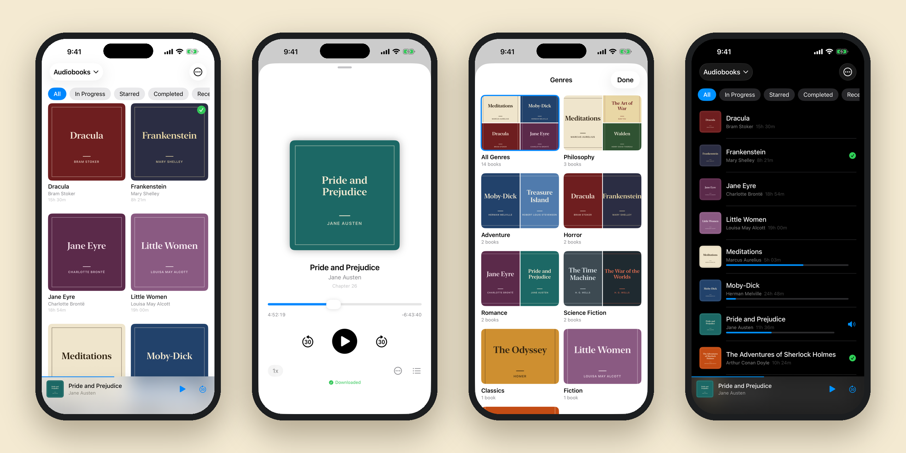

<p></p>

<h1>Shelf</h1>

<p>Your Google Drive audiobook library, with progress shared across macOS, iOS, and Android.<br>
Stream or download, then continue on another device.</p>

<p><strong>macOS</strong> · <strong>iOS</strong> · <strong>Android</strong></p>

<p>
  
  
  
  
</p>

<p><a href="https://github.com/madebysan/shelf/releases/latest">Download Shelf for macOS</a></p>

<p><a href="https://github.com/madebysan/shelf/releases/tag/android-v1.0.0">Download the Android APK</a></p>


Shelf reads an audiobook folder from Google Drive. Stream a book or save it locally, then continue from the same position on another device. It handles chapters, bookmarks, sleep timers, playback speed, cover lookup, and background playback without moving the library into a separate service.



Audio support covers m4b, m4a, mp3, and flac. Shelf can also play mp4, mov, mkv, avi, and webm video files. Progress exports as JSON and remains compatible across the three platforms.

## Platforms

The macOS app is the primary downloadable release. It includes a mini player, multiple libraries, sidebar navigation, and keyboard shortcuts on macOS 14 or later.

The Android release is available as an APK and supports streaming, offline downloads, background playback, haptics, and dark mode on Android 8 or later.

The iOS app currently builds from source. It supports background and lock-screen playback, Picture in Picture, AirPlay, and video thumbnails on iOS 17 or later.

## Build from source

Open the platform project you want to run:

```bash
# macOS
open macos/Shelf.xcodeproj

# iOS
open ios/ShelfIOS.xcodeproj

# Android
cd android
```

The Android app expects its Google services configuration under `android/app/google-services.json`.

## Free audio to get started

[Open Culture](https://www.openculture.com/freeaudiobooks) maintains a list of free audiobooks. Download the files, place them in a Google Drive folder, and point Shelf at that folder.

## License

[MIT](macos/LICENSE)

Made by [santiagoalonso.com](https://santiagoalonso.com)
