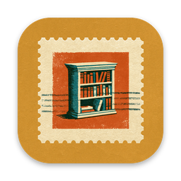

<h1>Bookdrive</h1>

Audiobook player for iPhone that plays your library straight from Google Drive. 
Stream or download a book, and pick up where you left off.

<strong>Version 1.0</strong> · iOS 17+

  
  
  

Bookdrive plays an audiobook folder in your Google Drive, for people who keep their own files and don't want to move them into another service.

- Stream a book, or download it to listen offline.
- Chapters, sleep timer, playback speed and lock-screen controls.
- Your place in every book is saved, so you continue where you stopped.

## How it works

Sign in with Google, point Bookdrive at your audiobook folder, and it builds a library with covers and genres. It plays m4b, m4a, mp3 and flac, and also mp4, mov, mkv, avi and webm video, with AirPlay and Picture in Picture. Need something to try it with? [Open Culture](https://www.openculture.com/freeaudiobooks) lists free audiobooks you can drop into a Drive folder.

## Install

Bookdrive isn't on the App Store yet. Open `ios/ShelfIOS.xcodeproj` in Xcode and choose your Apple Developer team under Signing & Capabilities. Google Sign-In is tied to the bundle identifier, so if you change it, create your own iOS client in Google Cloud and replace `GIDClientID` and its reversed URL scheme in `ios/ShelfIOS/Info.plist`.

---

[MIT](LICENSE)

Made by [santiagoalonso.com](https://santiagoalonso.com)
